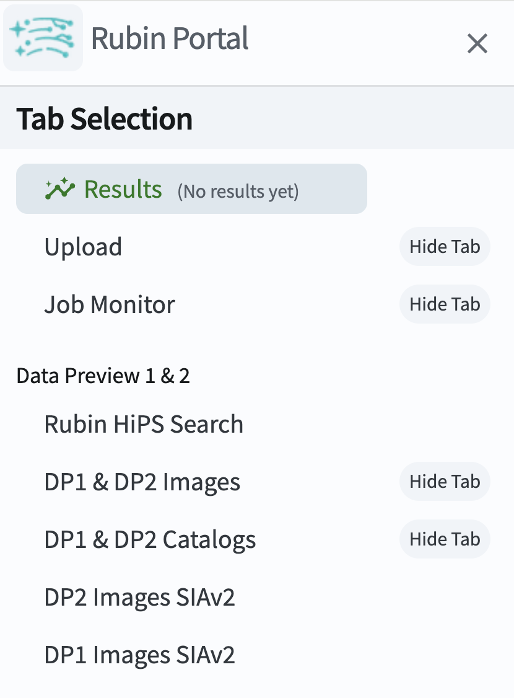
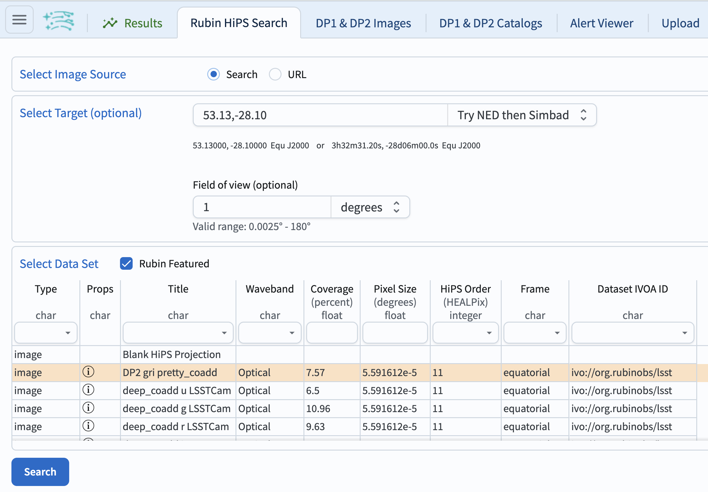
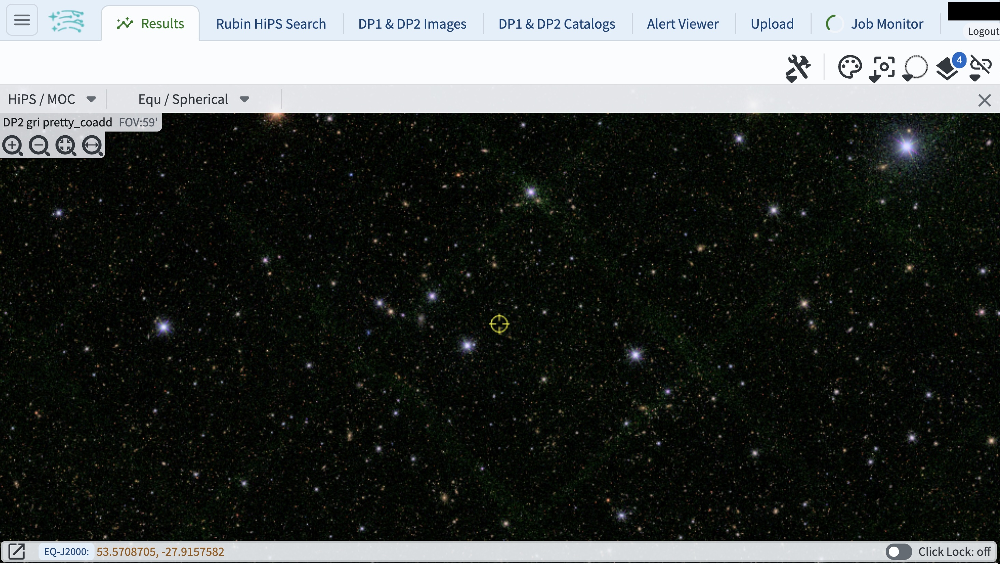

.. _portal-es-101-2:

################################
101.2. Explorando los mapas HiPS
################################

Para la Faceta Portal de la Plataforma Científica de Rubin (RSP) en data.lsst.cloud.

**Divulgación de Datos:** Vista Previa de Datos 2

**Última verificación de ejecución:** 2026-08-06

**Objetivo de aprendizaje:** Explorar los mapas de color de todo el cielo `HiPS <https://dp2.lsst.io/products/maps/hips.html>`_ (representación en mapas de Relevamientos Progresivos Jerárquicos (HiPS) de las imágenes coagregadas multibanda en mosaico).

**Productos de datos LSST:** Mapas HiPS

**Créditos:** Desarrollado originalmente por el equipo científico de la comunidad de Rubin.
Por favor, considerar reconocer su trabajo si este tutorial se utiliza para la preparación de artículos de revistas, lanzamientos de software u otros tutoriales.
DOI: `10.11578/rubin/dc.20250909.20 <https://doi.org/10.11578/rubin/dc.20250909.20>`_

**Soporte:** Se invita a toda la comunidad a hacer preguntas o plantear problemas en la `Categoría de asistencia <https://community.lsst.org/c/support/6>`_ del Foro de la Comunidad de Rubin.
El equipo de Rubin responderá a todas las preguntas publicadas allí.

----

**1. Iniciar sesión en el RSP y acceder a la Faceta Portal.**
En un navegador web, ir a `data.lsst.cloud <https://data.lsst.cloud/>`_, iniciar sesión y hacer clic en el panel de "Portal".

**2. En el menú lateral seleccionar "Rubin HiPS Search".**
Hacer clic en el menú de la barra lateral (tres líneas horizontales en la esquina superior izquierda) y hacer clic en Rubin HiPS Search (Búsqueda Rubin HiPS) (Figura 1).

    Figura 1: Seleccionar Rubin HiPS Search en el menú lateral.

**3. Seleccionar el objetivo y conjunto de datos.**
Junto a "Select Target" (Seleccionar objetivo), introducir las coordenadas ``53.13,-28.10``, que corresponden al centro del Campo Profundo Sur de Chandra Extendido (ECDFS, Extended Chandra Deep Field South), y un campo de visión (field of view) de ``1`` grado.
Bajo "Select Data Set" (Seleccionar conjunto de datos), hacer clic en la fila "DP2 gri pretty coadd", como se muestra en la Figura 2, y luego ejecutar la búsqueda haciendo clic en "Search" en la parte inferior izquierda.

    Figura 2: Ingresar coordenadas y campo de visión.

**4. Resultados.**
Los resultados de la búsqueda se muestran en la Figura 3.
Utilizar las funciones de desplazamiento del ratón o los botones de zoom
(íconos con forma de lupa en la esquina superior izquierda de la imagen)
para ampliar y desplazar la imagen.

    Figura 3: El mapa HiPS DP2 gri pretty coadd centrado en el campo ECDFS.

**5. Enlaces directos a los mapas HiPS de DP2.**
Utilizar los siguientes enlaces para ir a una región de DP2, y luego reducir el zoom para explorar.

* `Punto aleatorio en la región contigua <https://data.lsst.cloud/portal/app/?api=hips&uri=https://data.lsst.cloud/api/hips/v2/dp2/color_gri&ra=284.1701404&dec=-25.0224338&sr=2d>`_

Campos de perforación profunda (DDF):

* `DDF ELAIS S1, 00h38m00s -44d00m00s <https://data.lsst.cloud/portal/app/?api=hips&uri=https://data.lsst.cloud/api/hips/v2/dp2/color_gri&ra=9.5&dec=-44&sr=2d>`_
* `DDF ECDFS, 03h32m00s -28d06m00s <https://data.lsst.cloud/portal/app/?api=hips&uri=https://data.lsst.cloud/api/hips/v2/dp2/color_gri&ra=53&dec=-28.1&sr=2d>`_
* `DDF EDFS a, 03h56m48s -49d12m00s <https://data.lsst.cloud/portal/app/?api=hips&uri=https://data.lsst.cloud/api/hips/v2/dp2/color_gri&ra=59.2&dec=-49.2&sr=2d>`_
* `DDF EDFS b, 04h12m48s -47d48m00s <https://data.lsst.cloud/portal/app/?api=hips&uri=https://data.lsst.cloud/api/hips/v2/dp2/color_gri&ra=63.2&dec=-47.8&sr=2d>`_
* `DDF COSMOS, 10h00m24s +02d06m00s <https://data.lsst.cloud/portal/app/?api=hips&uri=https://data.lsst.cloud/api/hips/v2/dp2/color_gri&ra=150.1&dec=2.1&sr=2d>`_

Campos de áreas pequeñas:

* `M49, 12h25m12s +06d54m00s <https://data.lsst.cloud/portal/app/?api=hips&uri=https://data.lsst.cloud/api/hips/v2/dp2/color_gri&ra=186.3&dec=6.9&sr=2d>`_
* `Prawn, 16h54m00s -41d00m00s <https://data.lsst.cloud/portal/app/?api=hips&uri=https://data.lsst.cloud/api/hips/v2/dp2/color_gri&ra=253.5&dec=-41&sr=2d>`_
* `Trifid-Lagoon, 18h06m48s -23d54m00s <https://data.lsst.cloud/portal/app/?api=hips&uri=https://data.lsst.cloud/api/hips/v2/dp2/color_gri&ra=271.7&dec=-23.9&sr=2d>`_
* `New Horizons, 19h17m36s -20d12m00s <https://data.lsst.cloud/portal/app/?api=hips&uri=https://data.lsst.cloud/api/hips/v2/dp2/color_gri&ra=289.4&dec=-20.2&sr=2d>`_
* `Rubin SV 212 -7, 14h06m48s -07d00m00s <https://data.lsst.cloud/portal/app/?api=hips&uri=https://data.lsst.cloud/api/hips/v2/dp2/color_gri&ra=211.7&dec=-7&sr=2d>`_
* `Rubin SV 216 -17, 14h24m24s -16d42m00s <https://data.lsst.cloud/portal/app/?api=hips&uri=https://data.lsst.cloud/api/hips/v2/dp2/color_gri&ra=216.1&dec=-16.7&sr=2d>`_
* `Rubin SV 225 -40, 15h00m00s -39d30m00s <https://data.lsst.cloud/portal/app/?api=hips&uri=https://data.lsst.cloud/api/hips/v2/dp2/color_gri&ra=225&dec=-39.5&sr=2d>`_
* `Rubin SV 280 -48, 18h40m24s -48d00m00s <https://data.lsst.cloud/portal/app/?api=hips&uri=https://data.lsst.cloud/api/hips/v2/dp2/color_gri&ra=280.1&dec=-48&sr=2d>`_
* `Rubin SV 320 -15, 21h20m48s -15d06m00s <https://data.lsst.cloud/portal/app/?api=hips&uri=https://data.lsst.cloud/api/hips/v2/dp2/color_gri&ra=320.2&dec=-15.1&sr=2d>`_
