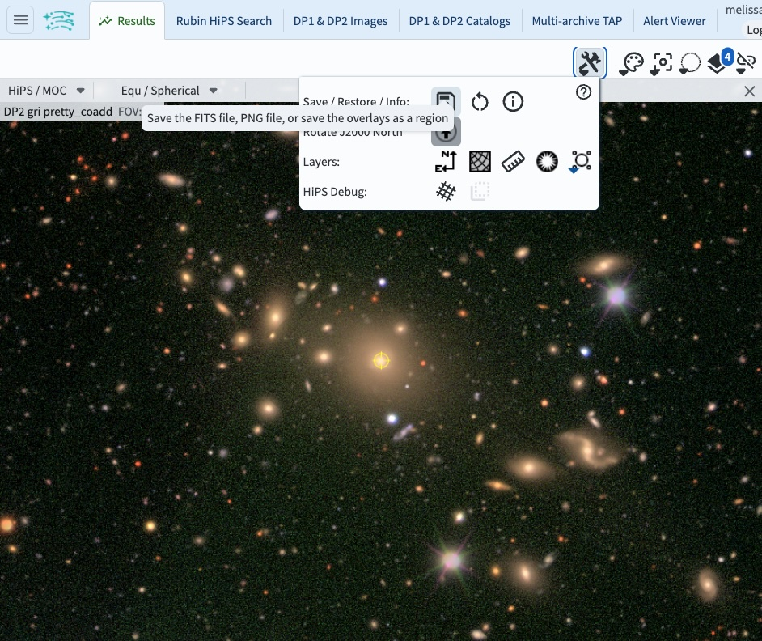

.. _portal-101-3:

####################################
101.3. Download a color cutout image
####################################

For the Portal Aspect of the Rubin Science Platform (RSP) at data.lsst.cloud.

**Data Release:** Data Preview 2

**Last verified to run:** 2026-11-18

**Learning objective:** Download a color cutout of a HiPS image.

**LSST data products:** N/A

**Credit:** Originally developed by the Rubin Community Science team.
Please consider acknowledging them if this tutorial is used for the preparation of journal articles, software releases, or other tutorials.
DOI: `10.11578/rubin/dc.20250909.20 <https://doi.org/10.11578/rubin/dc.20250909.20>`_

**Get Support:** Everyone is encouraged to ask questions or raise issues in the `Support Category <https://community.lsst.org/c/support/6>`_ of the Rubin Community Forum.
Rubin staff will respond to all questions posted there.

----

**1. Go to the RSP Portal's HiPS search interface.**
In a web browser, go to `data.lsst.cloud <https://data.lsst.cloud/>`_, click on the "Portal" panel, and log in.
Click on the sidebar menu (three vertical lines in the upper left hand corner) and click on Rubin HiPS Search (Figure 1).

**2. Select the target, cutout size, and data set.**
Next to "Select Target" enter the coordinates ``3h36m50.66s, -28d04m44.5s EQ_J2000`` (a pretty cluster in the Extended Chandra Deep Field South field) and a field of view of 5 arcminutes.
Under "Select Data Set" click on the row "DP2 gri pretty coadd" then click "Search" at lower left.

**3. Download the color cutout as a PNG.**
Above the color image, click on the "tools" icon (wrench and hammer) then on the "save" icon (floppy disk), as shown in Figure 1 below, to open the "Save Image" pop-up window (not shown).
Ensure the option to save as a PNG file is selected, alter the filename if desired, then click "Save" to download the color image.

    Figure 1: Under the "tools" icon, click the "save" icon to download the color cutout.
