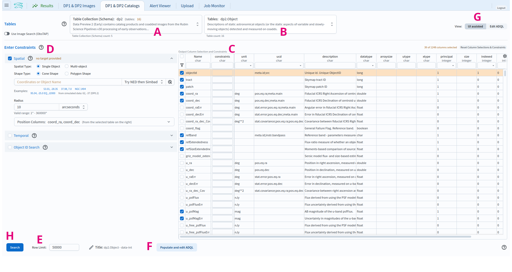
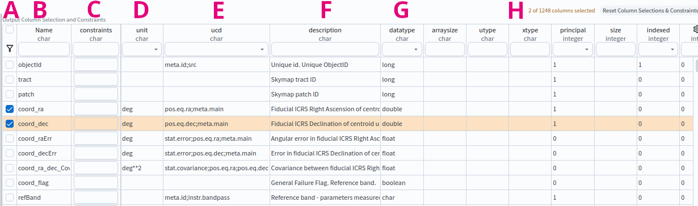
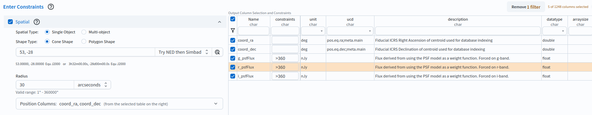

.. _portal-es-102-1:

#####################################
102.1. Consultando datos del catálogo
#####################################

Para la Faceta Portal de la Plataforma Científica de Rubin (RSP) en data.lsst.cloud.

**Divulgación de Datos:** Vista Previa de Datos 2

**Última verificación de ejecución:** 2026-09-07

**Objetivo de aprendizaje:** Configurar y ejecutar una consulta espacial para datos de catálogo con la interfaz gráfica de usuario (UI) del Portal, sin necesidad de escribir ADQL.

**Productos de datos LSST:** Tabla ``Object``

**Créditos:** Desarrollado originalmente por el equipo científico de la comunidad de Rubin.
Por favor, considerar reconocer su trabajo si este tutorial se utiliza para la preparación de artículos de revistas, lanzamientos de software u otros tutoriales.
DOI: `10.11578/rubin/dc.20250909.20 <https://doi.org/10.11578/rubin/dc.20250909.20>`_

**Soporte:** Se invita a toda la comunidad a hacer preguntas o plantear problemas en la `Categoría de asistencia <https://community.lsst.org/c/support/6>`_ del Foro de la Comunidad de Rubin.
El equipo de Rubin responderá a todas las preguntas publicadas allí.

----

**1. Iniciar sesión en el RSP y acceder a la Faceta Portal.**
En un navegador web, ir a `data.lsst.cloud <https://data.lsst.cloud/>`_, seleccionar el panel de la Faceta Portal e iniciar sesión.

**2. Seleccionar la pestaña DP1 & DP2 Catalogs.**
En la página de inicio del Portal, hacer clic en la pestaña denominada "DP1 & DP2 Catalogs" (Catálogos DP1 y DP2).

**3. Colocar el cursor sobre los elementos para ver notas emergentes.**
En la pestaña "DP1 & DP2 Catalogs" (Catálogos DP1 y DP2) (Figura 1), colocar el cursor por encima de los componentes de la interfaz o hacer clic en los signos de interrogación para ver explicaciones emergentes sobre la funcionalidad.

    Figura 1: Interfaz del Portal para consultar catálogos.

**4. Revisar los componentes de la interfaz.**
En la interfaz del Portal (Figura 1), revisar los componentes principales etiquetados de la A a la H, que se utilizan conjuntamente para consultar (buscar) y obtener datos.

* A: Menú desplegable "Table Collection (Schema)" (Colección de tablas [Esquema]). La opción ``dp2`` (productos de catálogos e imágenes coagregadas de la Vista Previa de Datos 2) se encuentra seleccionada de forma predeterminada.
* B: Menú desplegable "Tables" (Tablas) que muestra las tablas disponibles para la colección seleccionada. La tabla ``dp2.Object`` se encuentra seleccionada de forma predeterminada.
* C: Interfaz del esquema de la tabla denominada "Output Column Selection and Constraints" (Selección de columnas de salida y restricciones). Marcar la casilla de una columna para incluirla en los resultados y aplicar restricciones en el campo "constraints" para limitar los valores obtenidos. El botón "Reset Column Selections & Constraints" (Restablecer selección de columnas y restricciones), ubicado en la parte superior derecha, limpia todas las selecciones y restricciones.
* D: El área "Enter Constraints" (Ingresar restricciones) cuenta con los paneles desplegables "Spatial" (Espacial), "Temporal" y "Object ID Search" (Búsqueda por ID de objeto) para limitar la consulta.
* E: El campo de entrada "Row Limit" (Límite de filas) define el número máximo de filas que se extraerán de la tabla seleccionada.
* F: El botón "Populate and edit ADQL" (Completar y editar ADQL) convierte las restricciones definidas en C, D y E en una consulta ADQL editable.
* G: El botón selector "View" (Vista) permite cambiar entre "UI assisted" (esta interfaz gráfica) y "Edit ADQL" (Editar ADQL).
* H: El botón "Search" (Buscar) ejecuta la consulta y obtiene los datos en la pestaña Results (Resultados).

    Figura 2: Interfaz del esquema para la tabla ``Object``, con dos columnas seleccionadas (por ejemplo, ``coord_ra``, ``coord_dec``).

**5. Revisar los componentes de la interfaz del esquema.**
En la interfaz del esquema de la tabla (Figura 2), revisar los componentes etiquetados de la A a la H.

* A: Casillas de selección. Marcar una casilla para incluir la columna en los resultados. El ícono del embudo ubicado en la parte superior de la columna filtra la tabla para ver sólo las columnas seleccionadas.
* B: Nombre. Los nombres de las columnas son breves, descriptivos y únicos dentro de una tabla. Hacer clic en "Name" para ordenar por nombre.
* C: Restricciones. Aplicar límites a los valores de las columnas escribiendo las restricciones deseadas (por ejemplo, :math:`>, <, =, !=`).
* D: Unidad. Las unidades de los valores que se obtendrán.
* E: Descriptor de Contenido Unificado (UCD). Estándares de vocabulario establecidos por la `Alianza Internacional de Observatorios Virtuales <https://www.ivoa.net/>`_.
* F: Descripción de los datos de la columna.
* G: Tipo de los datos. Por ejemplo, ``double``, ``float``, ``long``, ``boolean``.
* H: "Reset Column Selections & Constraints", limpia todas las selecciones de columnas y restricciones.

**6. Hallar las columnas de interés.**
En la interfaz del esquema de la tabla (Figura 2), observar que se permite buscar nombres de columnas.
Escribir una palabra en el campo de entrada en la parte superior de cualquier columna para filtrar las filas.
Por ejemplo, en el campo de entrada debajo de "Name" (Nombre), escribir "Flux" (Flujo) y presionar "Enter" o "Return" (retorno) para ver todos los nombres de columnas que contienen la palabra "Flux".
Borrar el campo de entrada y presionar nuevamente "Enter" o "Return" para ver todos los nombres de columnas nuevamente.

**7. Establecer restricciones.**
A la izquierda, desplegar el panel "Spatial" (Espacial).
Establecer el tipo espacial como un único objeto seleccionando "Single Object" en "Spatial Type" y el tipo de forma como cónica seleccionando "Cone Shape" en "Shape Type",
ingresar ``53, -28`` (el centro aproximado del campo ECDFS) en el campo de coordenadas o nombre del objeto ("Coordinates or Object Name") y limitar el radio (Radius) a 30 segundos de arco.
En la interfaz del esquema de la tabla, seleccionar ``coord_ra``, ``coord_dec``, ``g_psfFlux``, ``r_psfFlux`` e ``i_psfFlux`` para obtener los datos de esas columnas,
y en el campo de restricciones ("constraints") ingresar ``>360`` para cada una de estas columnas ``g_psfFlux``, ``r_psfFlux`` e ``i_psfFlux`` de modo tal que sólo se obtengan objetos más brillantes que 360 nJy en las tres bandas.
Hacer clic en el ícono del embudo situado en la parte superior izquierda de la tabla para colapsarla y mostrar sólo las cinco filas seleccionadas (Figura 3); hacer clic nuevamente sobre el embudo para mostrar todas las columnas.
Este es un ejemplo de una consulta muy sencilla.

    Figura 3: Ejemplo de consulta para el catálogo ``Object`` de DP2 configurado en la interfaz.

**8. Ejecutar la búsqueda haciendo clic en "Search".**
En la parte inferior izquierda, hacer clic en el botón azul denominado "Search" (Buscar).
Esta consulta devolverá 22 filas de la tabla ``Object``.

**Próximos pasos:** Los tutoriales de la serie 103 muestran cómo convertir una consulta de la interfaz de usuario como esta a ADQL y cómo construir consultas directamente en ADQL.
Los tutoriales de la serie 104 muestran cómo trabajar con los resultados de los catálogos en la interfaz de resultados.
