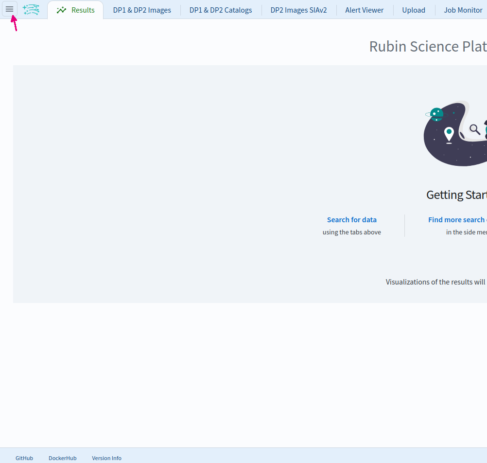
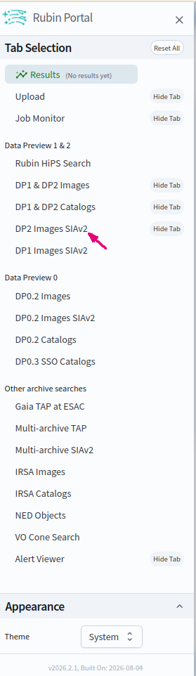
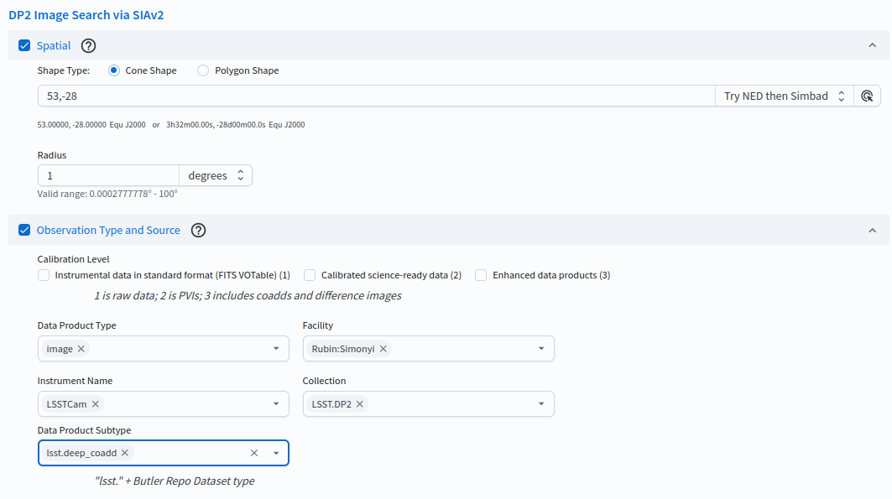
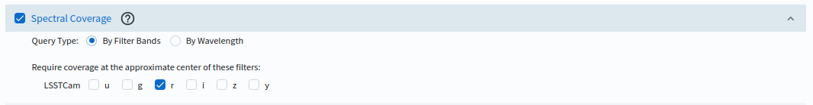
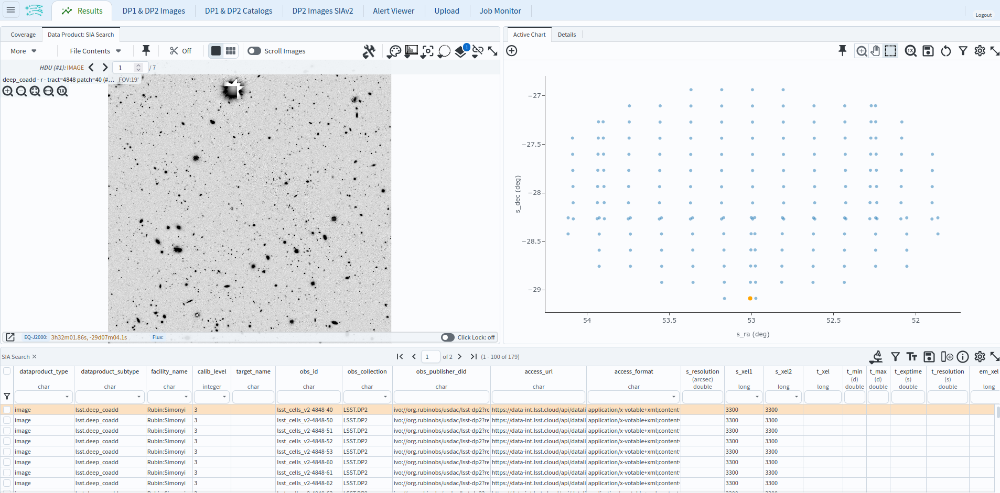

.. _portal-es-102-2:

#####################################
102.2. Consultando imágenes con SIAv2
#####################################

Para la Faceta Portal de la Plataforma Científica de Rubin (RSP) en data.lsst.cloud.

**Divulgación de Datos:** Vista Previa de Datos 2

**Última verificación de ejecución:** 2026-09-11

**Objetivo de aprendizaje:** Utilizar el servicio Simple Image Access version 2 (SIAv2) (Protocolo para Acceso de Imágenes versión 2) para configurar y realizar consultas de imágenes con la interfaz gráfica de usuario (UI) del Portal, sin necesidad de escribir ADQL.

**Productos de datos LSST:** ``deep_coadd``

**Créditos:** Desarrollado originalmente por el equipo científico de la comunidad de Rubin.
Por favor, considerar reconocer su trabajo si este tutorial se utiliza para la preparación de artículos de revistas, lanzamientos de software u otros tutoriales.
DOI: `10.11578/rubin/dc.20250909.20 <https://doi.org/10.11578/rubin/dc.20250909.20>`_

**Soporte:** Se invita a toda la comunidad a hacer preguntas o plantear problemas en la `Categoría de asistencia <https://community.lsst.org/c/support/6>`_ del Foro de la Comunidad de Rubin.
El equipo de Rubin responderá a todas las preguntas publicadas allí.

----

.. note::

   La Vista Previa de Datos Preliminares 2 sólo proporciona imágenes ``deep_coadd`` (coagregadas profundas).
   Imágenes de visita, diferenciales y de referencia serán agregadas con la divulgación completa de DP2; una vez que estén disponibles, la misma
   interfaz SIAv2 podrá ser utilizada para realizar consultas sobre ellas seleccionando el nivel de calibración y
   el subtipo de producto de datos correspondientes.

**1. Iniciar sesión en el RSP y acceder a la Faceta Portal.**
En un navegador web, ir a `data.lsst.cloud <https://data.lsst.cloud/>`_, seleccionar el panel de la Faceta "Portal" e iniciar sesión.

**2. Abrir el menú lateral.**
La búsqueda de imágenes mediante SIAv2 no es una de las pestañas predeterminadas; se accede a ella desde el menú lateral.
En la parte superior izquierda del Portal, hacer clic en el ícono de menú (tres líneas horizontales).

    Figura 1: El ícono de menú ubicado en la parte superior izquierda del Portal abre el menú lateral.

**3. Abrir la interfaz de búsqueda de imágenes SIAv2.**
En el menú lateral, bajo el título "Data Preview 1 & 2" (Vista Previa de Datos 1 y 2), hacer clic en "DP2 Images SIAv2".
Esto abrirá la pestaña "DP2 Images SIAv2" titulada "Búsqueda de Imágenes de DP2 mediante SIAv2" ("DP2 Image Search via SIAv2").
(Se provee una búsqueda de imágenes mediante SIAv2 por cada divulgación de datos; una entrada separada llamada "DP1 Images SIAv2" permite realizar consultas para DP1).

    Figura 2: Seleccionar "DP2 Images SIAv2" desde el menú lateral.

**4. Establecer las restricciones espaciales.**
Marcar la casilla junto a "Spatial" (Espacial).
Elegir un área cónica seleccionando la opción "Cone Shape" en el campo "Shape Type".
En el campo de Coordenadas o Nombre de Objeto ("Coordinates or Object Name") ingresar el centro aproximado del campo ECDFS, RA, Dec = 53, -28 grados.
Configurar las unidades del radio en grados ("degrees") y establecer un radio ("Radius") de 1, aproximadamente el tamaño del campo.

**5. Establecer el tipo de observación y la fuente.**
Marcar la casilla junto a "Observation Type and Source" (Tipo de observación y fuente).
Establecer el tipo de producto de datos como imagen escribiendo "image" en el campo "Data Product Type",
la instalación en "Rubin:Simonyi" en el campo "Facility",
el nombre del instrumento en "LSSTCam" en el campo "Instrument Name",
la colección en "LSST.DP2" en el campo "Collection"
y el subtipo de producto de datos en "lsst.deep_coadd" en el campo "Data Product Subtype".

    Figura 3: Configuración de las restricciones espaciales y de tipo de observación y fuente de las imágenes.

**6. Establecer la cobertura espectral (filtro).**
Marcar la casilla junto a "Spectral Coverage" (Cobertura espectral).
Seleccionar el tipo de consulta por bandas de filtros con la opción "By Filter Bands" en el campo "Query Type" y seleccionar la banda *r* bajo "LSSTCam".

    Figura 4: Configuración de las restricciones de cobertura espectral de las imágenes.

**7. Ejecutar la búsqueda.**
Hacer clic en el botón "Search" (Buscar) situado en la parte inferior izquierda.

**8. Revisar los resultados.**
La interfaz de resultados permite visualizar interactivamente las 179 imágenes ``deep_coadd`` (coagregadas profundas) que cumplen con
los criterios de búsqueda: las imágenes coagregadas en banda *r* de cada parcela del ECDFS que cae dentro del cono de búsqueda.

    Figura 5: La interfaz de resultados de imágenes.

**Próximos pasos:** El tutorial 102.3 realiza una consulta de imágenes similar con el servicio ObsTAP en lugar de SIAv2, y
los tutoriales de la serie 105 muestran cómo trabajar con los resultados de imágenes en el visor Firefly.
