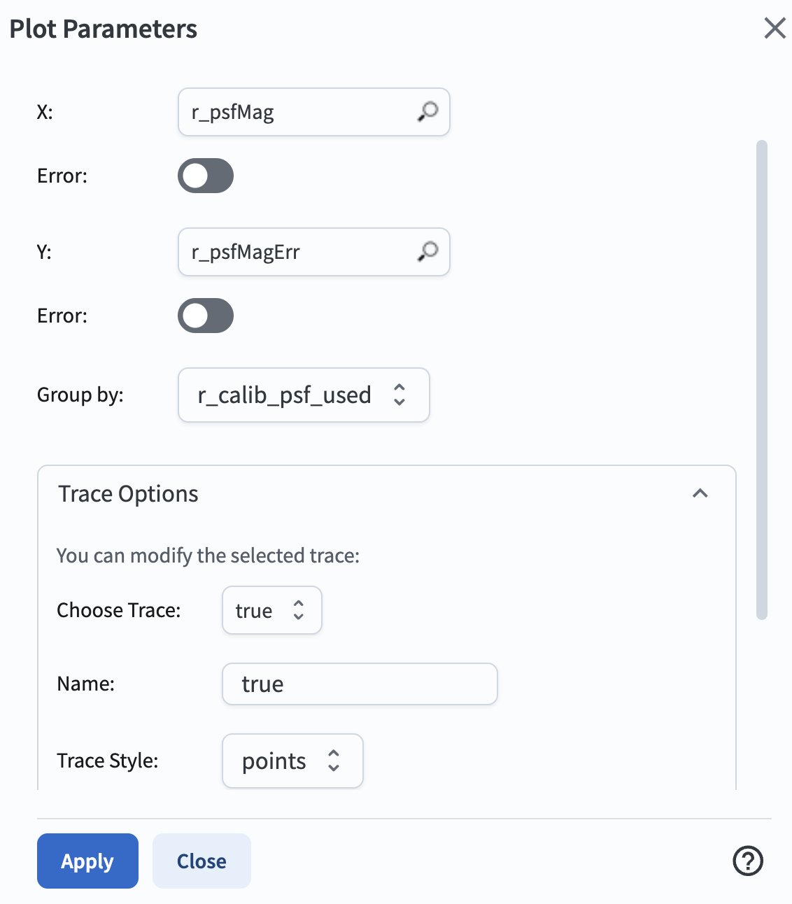
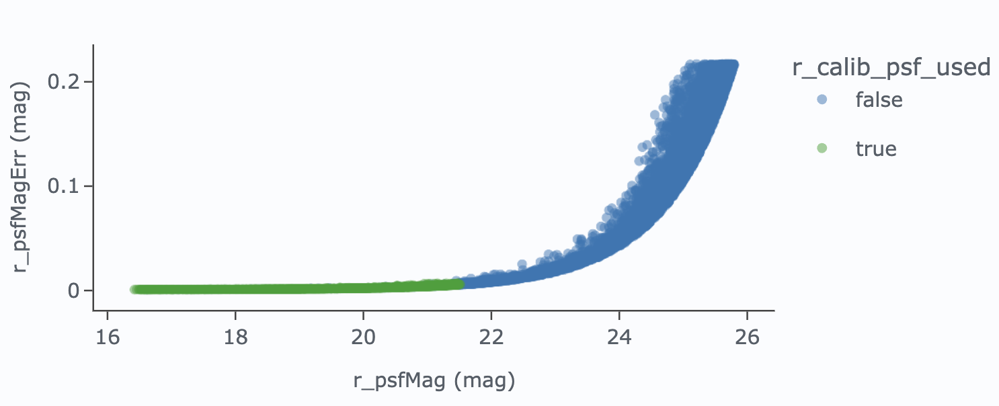
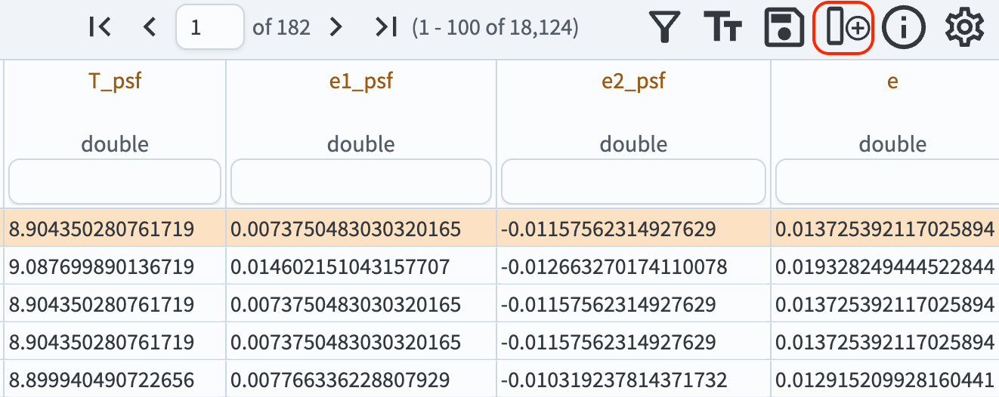
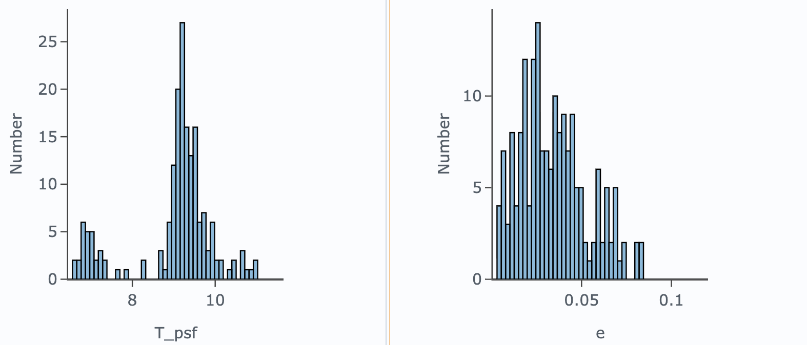
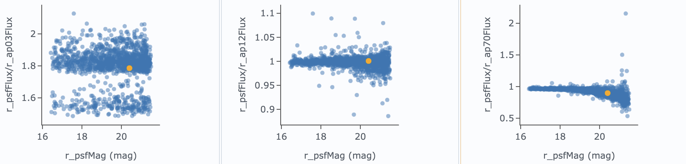

.. _portal-302-1:

###############################
302.1. PSF Photometry for stars
###############################

For the Portal Aspect of the Rubin Science Platform at data.lsst.cloud.

**Data Release:** DP2

**Last verified to run:** 2026-11-03

**Learning objective:** To understand the Point Spread Function (PSF) photometry for stars.

**LSST data products:** ``Object``

**Credit:** Originally developed by the Rubin Community Science team.
Please consider acknowledging them if this tutorial is used for the preparation of journal articles, software releases, or other tutorials.
DOI: `10.11578/rubin/dc.20250909.20 <https://doi.org/10.11578/rubin/dc.20250909.20>`_

**Get Support:** Everyone is encouraged to ask questions or raise issues in the `Support Category <https://www.rubin.community/c/support/6>`_ of the Rubin Community Forum.
Rubin staff will respond to all questions posted there.

----

**1. Execute an ADQL query for stars.**
Log in to the Portal Aspect, select the "DP1 & DP2 Catalogs" tab, and click "Edit ADQL" at upper right.
Enter the following ADQL statement and click "Search" at lower left.
The query retrieves PSF photometry, PSF second moments, aperture fluxes at multiple radii, and the flags that indicate whether an object was used for PSF modeling or reserved for PSF evaluation, from the ``Object`` table within a circular region of 0.5-degree radius centered on the ECDFS field (RA = 53.13, Dec = -28.10).
It restricts the results to point sources (``r_extendedness`` = 0) with signal-to-noise ratio > 5 and requires ``r_pixelFlags_inexact_psfCenter`` = 0 to exclude objects with a discontinuous PSF at the centroid.

.. code-block:: SQL

  SELECT
    r_psfMag, r_psfMagErr, r_psfFlux,
    r_ixxPSF, r_iyyPSF, r_ixyPSF,
    r_ap03Flux, r_ap12Flux, r_ap70Flux,
    r_calib_psf_used, r_calib_psf_reserved
  FROM dp2.Object
  WHERE CONTAINS(POINT('ICRS', coord_ra, coord_dec),
                 CIRCLE('ICRS', 53.13, -28.10, 0.5)) = 1
  AND r_extendedness = 0
  AND r_psfFlux / r_psfFluxErr > 5
  AND r_pixelFlags_inexact_psfCenter = 0

The query should return 18,124 rows, including 1,430 stars used in PSF modeling ("PSF stars") and 181 stars reserved for PSF evaluation ("PSF-reserved stars").

**2. Plot photometric uncertainty.**
Visualize photometric uncertainty as a function of magnitude for all selected stars and for the PSF stars.
In the "Active Chart" panel, click the "+" icon to add a chart.
Choose "Scatter" as the plot type, set the x-axis to ``r_psfMag`` and the y-axis to ``r_psfMagErr``, and click "OK" to display the plot.
Delete the default chart of RA and Dec coordinates.
Click the gear icon to open the "Plot Parameters" pop-up window.
Set the "Group by" option to ``r_calib_psf_used`` and click "Apply".
The "Choose Trace" option should now appear.
Set it to "true" (i.e., the trace will highlight the PSF stars) and click "Apply", as shown in Figure 1.
The resulting plot should look like Figure 2.

    Figure 1: The interface to set plot parameters. It is configured to show ``r_psfMag`` on the x-axis and its errors on the y-axis, and to group by the ``r_calib_psf_used`` flag.

    Figure 2: ``r_psfMagErr`` vs. ``r_psfMag`` for the non-PSF stars (blue circles) and the PSF stars (green circles) in the field. PSF stars are bright and have uncertainties below 1 percent, consistent with the precision achieved by all bright stars.

**3. Assess PSF model performance.**
The LSST Science Pipelines quantify PSF model performance via the object size estimator *T* (the trace of the second-moment matrix) and the ellipticity components *e1* (elongation along the pixel axes) and *e2* (elongation along the diagonals). Compute *T*, *e1*, *e2*, and the total ellipticity *e* for the stars in the table by adding four new columns.
Click the "Add a column" icon in the table toolbar (marked with a red box in Figure 3), name the new column ``T_psf``, and enter the expression ``r_ixxPSF + r_iyyPSF``. Repeat this for ``e1_psf`` with ``(r_ixxPSF - r_iyyPSF) / T_psf``, for ``e2_psf`` with ``2 * r_ixyPSF / T_psf``, and for ``e`` with ``sqrt(power(e1_psf, 2) + power(e2_psf, 2))``.

    Figure 3: A portion of the results table with four new columns added: ``T_psf``, ``e1_psf``, ``e2_psf``, and ``e``. The "Add a column" icon is marked with a red box.

Add a new chart. Set the plot type to "Histogram", select ``T_psf`` as the column to plot, and click "OK". Add a second histogram in the same way for the total ellipticity ``e`. To restrict both histograms to the PSF-reserved stars, set the table column condition for ``r_calib_psf_reserved`` to "=true". Delete the scatter plot from Step 2. The two histograms should look like Figure 4.

    Figure 4: Histograms of the trace of the second-moment matrix, ``T_psf`` (left), and the total ellipticity, ``e`` (right), for the 181 PSF-reserved stars. The median T ~ 9 pixel² corresponds to a full width at half maximum of about 1 arcsec, given the 0.2 arcsec pixel scale. The ellipticities are small, with most stars below e ~ 0.05, indicating a nearly round PSF model at the positions of the reserved stars.

**4. Compare PSF and aperture fluxes.**
In principle, a properly normalized PSF model integrates to 100% of a point source's flux, whereas a circular aperture measures only the flux enclosed within its radius.
In practice, small apertures miss flux, and large apertures admit contamination from neighboring sources and the sky background.
This step compares the circular-aperture fluxes (radii of 3 to 70 pixels, centered on the stellar positions) to the PSF fluxes.

Create a new scatter plot of the ratio of PSF flux to the 3-pixel aperture flux as a function of PSF magnitude: set the x-axis to ``r_psfMag`` and enter the expression ``r_psfFlux / r_ap03Flux`` in the y-axis field.
Repeat this for the 12-pixel and 70-pixel apertures (``r_ap12Flux`` and ``r_ap70Flux``).
The three plots should look like the panels in Figure 5.

    Figure 5: Each panel shows the ratio of PSF flux to aperture flux as a function of PSF magnitude for stars in the field, for aperture radii of 3, 12, and 70 pixels. Ratios > 1 indicate that the aperture is too small to capture the total stellar flux, while ratios < 1 suggest contamination from neighboring sources when the aperture is too large.