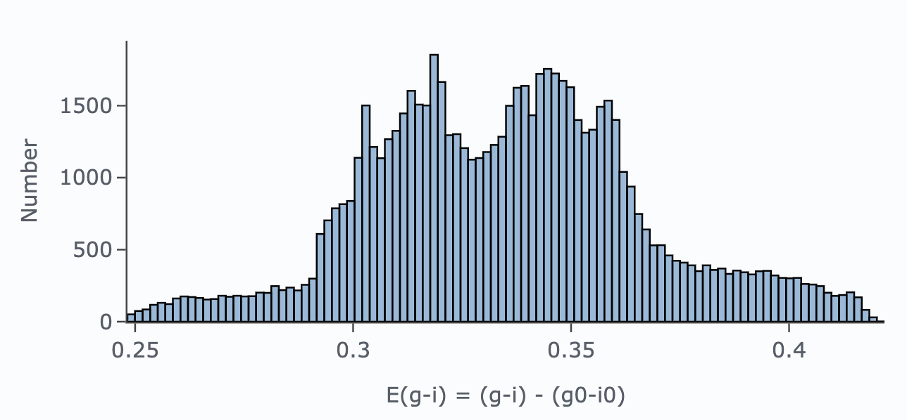
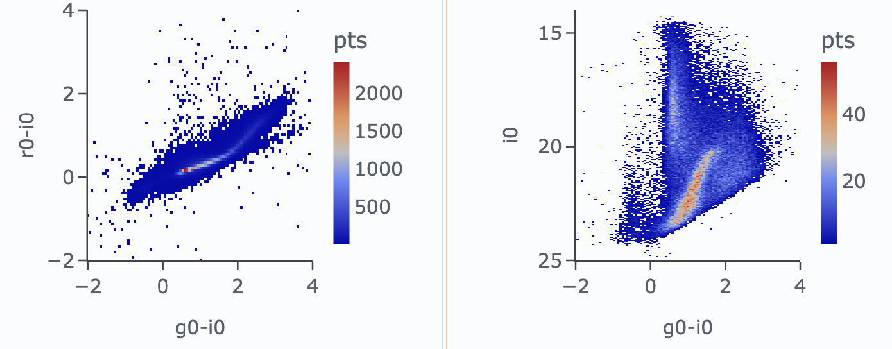

.. _portal-302-2:

#####################################
302.2. Stellar multi-color photometry
#####################################

For the Portal Aspect of the Rubin Science Platform at data.lsst.cloud.

**Data Release:** DP2

**Last verified to run:** 2026-11-04

**Learning objective:** Explore stellar color-magnitude and color-color diagrams in DP2.

**LSST data products:** ``Object``

**Credit:** Originally developed by the Rubin Community Science team.
Please consider acknowledging them if this tutorial is used for the preparation of journal articles, software releases, or other tutorials.
DOI: `10.11578/rubin/dc.20250909.20 <https://doi.org/10.11578/rubin/dc.20250909.20>`_

**Get Support:** Everyone is encouraged to ask questions or raise issues in the `Support Category <https://www.rubin.community/c/support/6>`_ of the Rubin Community Forum.
Rubin staff will respond to all questions posted there.

----

**1. Execute an ADQL query for stars in the NGC 6822 field.**
Log in to the Portal Aspect, select the "DP1 & DP2 Catalogs" tab, and click "Edit ADQL" at upper right.
Enter the following ADQL statement, set the row limit to 100,000, and click "Search" at lower left.
The query retrieves coordinates, PSF photometry in *gri*, and *E(B-V)* values within a 0.5-degree radius centered on NGC 6822 (RA = 296.24, Dec = -14.8). It restricts the results to point sources (``refExtendedness`` = 0) with a PSF flux signal-to-noise ratio greater than 5 in *gri*.

.. code-block:: SQL

  SELECT coord_ra, coord_dec, g_psfMag, r_psfMag, i_psfMag, ebv
        FROM dp2.Object
        WHERE CONTAINS(POINT('ICRS', coord_ra, coord_dec),
              CIRCLE('ICRS', 296.24, -14.8, 0.5)) = 1
        AND refExtendedness = 0
        AND g_psfFlux/g_psfFluxErr > 5
        AND r_psfFlux/r_psfFluxErr > 5
        AND i_psfFlux/i_psfFluxErr > 5

The query should return 70,838 rows.

**2. Apply dust correction.**
Use the extinction coefficients for the Rubin filters for dust correction: $R_g = 3.66$, $R_r = 2.70$, and $R_i = 2.05$. These coefficients are derived from the CCM89 extinction law (Cardelli, Clayton, & Mathis 1989), assuming a flat spectral energy distribution and a default total-to-selective extinction ratio of $R_V = 3.1$, representative of the diffuse Milky Way interstellar medium. To add columns for the dust-corrected magnitudes, click the "Add a column" icon in the table toolbar, name the new column ``g0``, and enter the expression ``g_psfMag`` - 3.66 x ``ebv``. Repeat this for ``r0`` with the expression ``r_psfMag`` - 2.70 x ``ebv``, and for ``i0`` with the expression ``i`` - 2.05 x ``ebv``.

**3. Plot the $E(g-i)$ color excess.**
Visualize the $E(g-i)$ color excess. In the "Active Chart" panel, click the "+" icon to add a chart.
Choose "Histogram" as the plot type, enter (``g_psfMag`` - ``i_psfMag``) - (``g0`` - ``i0``) into the expression field, set the number of bins to 100, set the x-axis label to "E(g-i) = (g - i) - (g0 - i0)", and click OK to generate the plot. Delete the default chart of RA and Dec coordinates.

    Figure 1: The $E(g-i)$ color excess. Color excess quantifies interstellar reddening by measuring how much redder an observed star appears compared to its intrinsic, unreddened color: $E(g-i) = (g - i)_{obs} - (g - i)_0$.

**4. Plot the CCD and CMD.**
Plot the color-color and color-magnitude diagrams (CCD and CMD, respectively) using the dust-corrected magnitudes ``g0``, ``r0``, and ``i0``. Click the "+" icon to add a chart, and choose "Heatmap" as the plot type. Set the x-axis to ``g0``-``i0`` and the y-axis to ``r0``-``i0``, using 300 bins for both axes. Finally, set the range for both axes from -2 to 4, and click OK to display the plot. The resulting plot should look like Figure 2. Repeat the same steps for the CMD, but set the y-axis to ``i0`` and its range from 14 to 25 with the "reverse" option enabled.

    Figure 2: The CCD (left) and CMD (right) of stars in the NGC 6822 field, constructed with dust-corrected magnitudes ``g0``, ``r0``, and ``i0``. Stars form a well-defined locus in the CCD. In the CMD, distinct stellar populations are visible: the blue plume at $-0.5 < ``g0``-``i0`` < 0$ corresponds to upper main-sequence stars belonging to NGC 6822; the densest feature at 0 < ``g0``-``i0`` < 2 and 20 < ``i0`` < 24 traces the NGC 6822 red-giant sequence; and the vertical structure near ``g0``-``i0`` ~ 0.9 is composed of Milky Way foreground main-sequence turnoff stars.