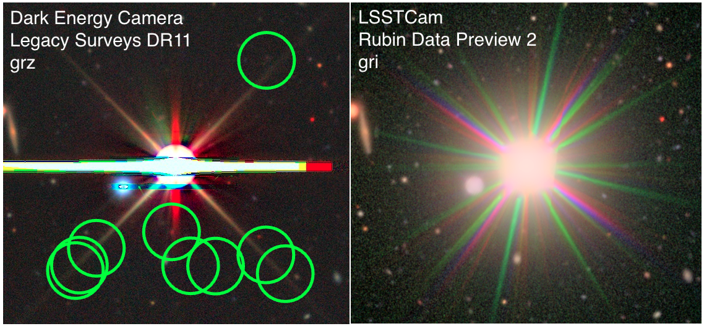
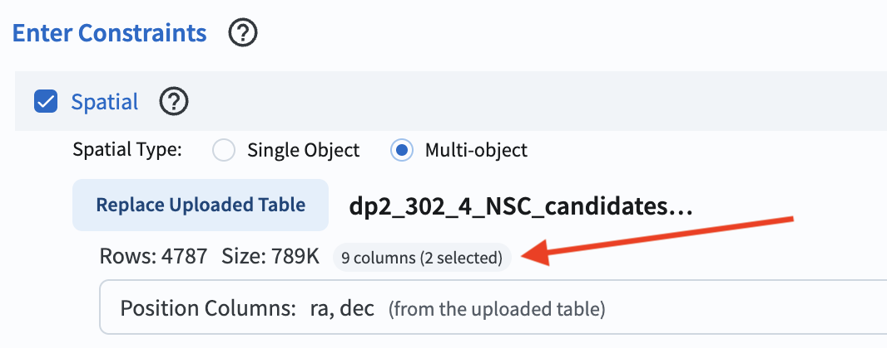
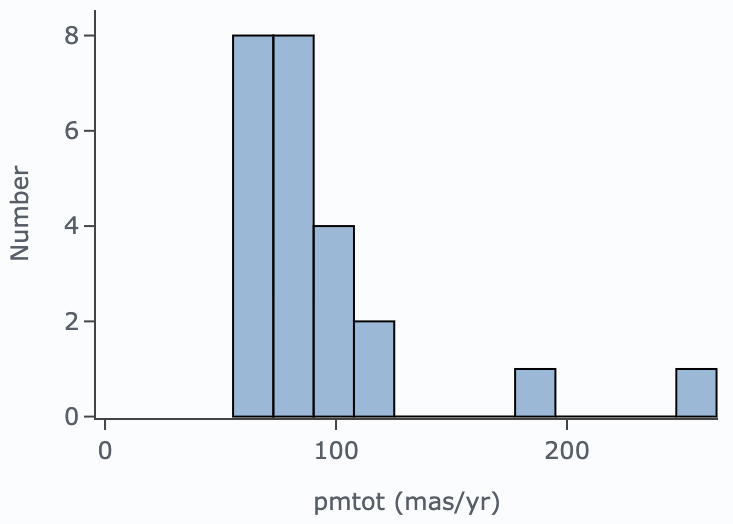

.. Review the README on instructions to contribute.
.. Review the style guide to keep a consistent approach to the documentation.
.. Static objects, such as figures, should be stored in the _static directory. Review the _static/README on instructions to contribute.
.. Do not remove the comments that describe each section. They are included to provide guidance to contributors.
.. Do not remove other content provided in the templates, such as a section. Instead, comment out the content and include comments to explain the situation. For example:
	- If a section within the template is not needed, comment out the section title and label reference. Do not delete the expected section title, reference or related comments provided from the template.
    - If a file cannot include a title (surrounded by ampersands (#)), comment out the title from the template and include a comment explaining why this is implemented (in addition to applying the ``title`` directive).

.. This is the label that can be used for cross referencing this file.
.. Recommended title label format is "Directory Name"-"Title Name" -- Spaces should be replaced by hyphens.
.. _Tutorials-Examples-DPX-Aspect-Y:
.. Each section should include a label for cross referencing to a given area.
.. Recommended format for all labels is "Title Name"-"Section Name" -- Spaces should be replaced by hyphens.
.. To reference a label that isn't associated with an reST object such as a title or figure, you must include the link and explicit title using the syntax
.. A warning will alert you of identical labels during the linkcheck process.

###########################################
302.4. Faint proper motion source selection
###########################################

For the Portal Aspect of the Rubin Science Platform at data.lsst.cloud.

**Data Release:** DP2

**Last verified to run:** 2026-11-15

**Learning objective:** Use the ``IsolatedStarStellarMotions`` table to help identify high proper motion sources beyond Gaia's depth.

**LSST data products:** ``IsolatedStarStellarMotions``

**Credit:** Originally developed by the Rubin Community Science team.
Please consider acknowledging them if this tutorial is used for the preparation of journal articles, software releases, or other tutorials.
DOI: `10.11578/rubin/dc.20250909.20 <https://doi.org/10.11578/rubin/dc.20250909.20>`_.
The NOIRLab Source Catalog is described in `Nidever et al. 2018 <https://iopscience.iop.org/article/10.3847/1538-3881/aad68f>`_ and `Nidever et al. 2021 <https://iopscience.iop.org/article/10.3847/1538-3881/abd6e1>`_. This research used services or data provided by the Astro Data Lab, which is part of the Community Science and Data Center (CSDC) Program of NSF NOIRLab (`Fitzpatrick et al. 2014 <https://noirlab.edu/science/sites/default/files/media/archives/documents/scidoc1206.pdf>`_; `Nikutta et al. 2020 <https://doi.org/10.1016/j.ascom.2020.100411>`_). NOIRLab is operated by the Association of Universities for Research in Astronomy (AURA), Inc. under a cooperative agreement with the U.S. National Science Foundation.

**Get Support:** Everyone is encouraged to ask questions or raise issues in the `Support Category <https://community.lsst.org/c/support/6>`_ of the Rubin Community Forum. Rubin staff will respond to all questions posted there.

.. _DPX-Aspect-Y-Intro:

Introduction
============

The ``IsolatedStarStellarMotions`` table provides Rubin-based proper motion measurements for hundreds of millions of isolated stars. Gaia proper motion solutions are used as priors where available. For relatively faint stars detected by Rubin, Gaia does not provide proper motion solutions. This tutorial shows an example of using the ``IsolatedStarStellarMotions`` table to identify faint high proper motion sources that lack Gaia proper motion solutions. This tutorial focuses on the ELAIS S1 deep drilling field, which provides a footprint with hundreds of overlapping LSSTCam exposures that span a ~200 day time baseline in DP2.

Searches for rare objects like high proper motion stars inherently select outliers in the catalog, and therefore generally suffer from high false positive rates due to noise excursions and artifacts which are rare but may be less rare than the targets of interest. To assemble a bona-fide sample of high proper motion objects in the ELAIS S1 field, this tutorial begins with a large, unvetted sample of high proper motion candidates selected from NOIRLab Source Catalog (NSC) Data Release 2 (DR2), based on Dark Energy Camera (DECam) observations of this field during the 2010's. This initial, unvetted list of candidates, which contains many false positives, is then cross-referenced with high proper motion objects selected from the Rubin DP2 ``IsolatedStarStellarMotions`` table to create a pure sample of bona-fide high proper motion objects in the ELAIS S1 field that are too faint to have Gaia proper motion measurements. The cross-match between ``IsolatedStarStellarMotions`` and NSC makes it possible to confirm the high proper motions reported by the ``IsolatedStarStellarMotions`` table and by NSC, in the absence of available proper motions from Gaia. The purity of the sample for which DP2 and NSC agree on each source's high proper motions is achieved thanks to the fact that, while both DP2 and NSC have noise and artifacts, the noise and artifacts are generally uncorrelated in these two independent datasets.

**Related tutorials:** See the Portal 106-series tutorial about user-uploaded tables.

.. _DPX-Aspect-Y-1:

1. Upload a table of unvetted candidate high proper motion objects
==================================================================

The initial list of several thousand unvetted high proper motion candidates in the ELAIS S1 field was obtained by querying the NOIRLab Source Catalog via NOIRLab's `Astro Data Lab <https://datalab.noirlab.edu/>`_. This list of unvetted NSC candidates includes legitimate high proper motion stars mixed with contaminants due to artifacts and noise. The NSC list of high proper motion candidates was selected from the NSC DR2 ``Object`` table according to the following criteria:

- within 1.1° of (RA, Dec) = (9.5°, -44°)
- at least 8 detections by NSC in individual exposures
- no Gaia DR3 source with proper motions available within 3 arcseconds
- total proper motion > 50 mas/yr, where total proper motion is defined as :math:`\mu = \sqrt{\mu^2_{\alpha} + \mu^2_{\delta}}`
- significance of motion > 30, where significance of motion is defined as :math:`X^2_{\rm motion} = (\mu_{\alpha}/\sigma_{\mu_{\alpha}})^2 + (\mu_{\delta}/\sigma_{\mu_{\delta}})^2`
- time baseline of NSC detections for the object is > 1000 days

Note that additional NSC cuts may be possible, for instance on its ``flags`` column.

The NSC proper motion selection includes false positives, and the goal is to use the Rubin DP2 ``IsolatedStarStellarMotions`` table in combination with NSC DR2 to isolate a pure sample of high proper motion objects. Figure 1 illustrates that the images used to create both NSC (DECam images) and DP2's ``IsolatedStarStellarMotions`` (LSSTCam images) have artifacts like diffraction spikes, but these artifacts are poorly correlated, allowing for selection of a pure sample whose members have high proper motions reported in *both* DP2 and NSC.

    Figure 1: Left - NSC high proper motion selection contaminants (at centers of green circles) related to a bright star in the ELAIS S1 deep drilling field. The background image is a Dark Energy Camera (DECam) color composite from DESI Legacy Surveys DR11 (`Dey et al. 2019 <https://iopscience.iop.org/article/10.3847/1538-3881/ab089d>`_). Right - DP2 gri 'pretty coadd' of the same sky region, showing that artifacts like diffraction spikes, while present in both datasets, are poorly correlated, allowing for a pure sample to be selected by requiring high proper motion to be reported in both DP2 and NSC. Each cutout is approximately 1.9 arcminutes on a side.

**1.1. Log in to the Portal Aspect of the Rubin Science Platform.**
In a browser, go to the URL `data.lsst.cloud <https://data.lsst.cloud>`_ and select the Portal Aspect.
Follow the process to log in.

**1.2. Select the DP1 & DP2 Catalogs tab in the Portal.**
This tutorial uses the UI assisted interface of the RSP Portal Aspect.

**1.2. Download the file of NSC proper motion candidates.** :download:`Download dp2_302_4_NSC_candidates.csv <../../../../_static/tutorials/dp2_302_4_NSC_candidates.csv>`.

**1.3. Upload the file of NSC proper motion candidates.**
Within the Portal's UI assisted query interface, ensure that only "Spatial" is checked under "Enter Constraints". Under "Spatial", select the "Multi-object" option for "Spatial Type". This brings up a window to upload the downloaded CSV file of proper motion candidates. Within this window, select "Choose file" and choose ``dp2_302_4_NSC_candidates.csv`` that you downloaded. Click "Load Table".

**1.4. Customize the uploaded table's selection of columns.**
Click on the text that says ``9 columns (2 selected)`` (Figure 2).

    Figure 2: The red arrow annotation points to the text to click to customize the selection of columns that the query will retain from the user-uploaded table.

This brings up an interface to select additional columns. Leave both ``ra`` and ``dec`` columns selected, and additionally select ``pmra`` (the NSC RA proper motion in mas/yr), ``pmdec`` (the NSC Dec proper motion in mas/yr), and ``pmraerr`` and ``pmdecerr`` which are the uncertainties on the NSC proper motions. Once you have selected these 4 additional columns and exited the user-uploaded table column selection window, the Portal interface should show ``9 columns (6 selected)``

.. _DPX-Aspect-Y-2:

2. Cross-match to the ``IsolatedStarStellarMotions`` table
==========================================================

**2.1. Select the IsolatedStarStellarMotions table in the UI interface.**
Near the upper portion of the Portal's UI assisted inerface, select ``dp2.IsolatedStarStellarMotions`` within the Tables dropdown. If selecting the ``IsolatedStarStellarMotions`` checks the "Temporal" box under "Enter Constraints", then uncheck "Temporal".

**2.2. Set the cross-match radius.**
Set the cross-match radius to 3 arcseconds using the "Radius" text box.

**2.3. Run the query.**
Run the cross-match between the uploaded table and the ``IsolatedStarStellarMotions`` table by clicking "Search" near bottom left. This will take you to the query results page once the query completes.

3. Compute additional proper motion metrics
===========================================

The results table includes columns from both the ``IsolatedStarStellarMotions`` table and from the user-uploaded table of NSC candidates. Add two more columns, computed based on the ``IsolatedStarStellarMotions`` columns retrieved via the Portal query:

- ``pmtot``, given by :math:`\mu = \sqrt{\mu^2_{\alpha} + \mu^2_{\delta}}`, where within the ``IsolatedStarStellarMotions`` table :math:`\mu_{\alpha}` is column ``rapm`` and :math:`\mu_{\delta}` is column ``decpm``
- ``chi2_motion``, defined as :math:`X^2_{\rm motion} = (\mu_{\alpha}/\sigma_{\mu_{\alpha}})^2 + (\mu_{\delta}/\sigma_{\mu_{\delta}})^2`, where within the ``IsolatedStarStellarMotions`` table :math:`\sigma_{\mu_{\alpha}}` is column ``rapmerr`` and :math:`\sigma_{\mu_{\delta}}` is column ``decpmerr``.

**3.1. Add a total proper motion column.**
Click on the "Add a column" icon (rectangle with encircled plus mark) within the Results tab. Define a new column with Name of ``pmtot``, and Expression of ``sqrt(power(raPM,2) + power(decPM,2))`` then click the "Add column" button.

**3.2. Add a significance of motion column.**
Click the "Add a column" icon again. Define a second new column with Name of ``chi2_motion``, and Expression of ``power(raPM/raPMErr,2) + power(decPM/decPMErr,2)``, then click the "Add column" button.

4. Filter for bona-fide high proper motion sources
==================================================

**4.1. Click the "Table Options" gear icon in the table panel.**
This brings up a Table Options window with a table of the available columns. Scroll all the way down to see the newly added ``pmtot`` and ``chi2_motion`` columns.

**4.2. Filter on high total proper motion.**
In the "filter" column, enter ``> 50`` for ``pmtot`` to select stars with Rubin DP2 total proper motions > 50 mas/yr.

**4.3. Filter on high significance of motion.**
Enter ``> 30`` for ``chi2_motion`` in the ``filter`` column to select stars with highly significant proper motions according to the DP2 ``IsolatedStarStellarMotions`` catalog.

**4.4. Click the "Close" button on the Table Options window.**

5. Compare Rubin DP2 versus NSC proper motions
==============================================

**5.1. Compare proper motions along right ascension.**
In the Active Charts panel of the Results tab, click the encircled plus symbol to add a chart. This brings up an Add New Chart window. For Plot Type, select "Scatter". For X, select ``raPM``, the ``IsolatedStarStellarMotions`` RA proper motion. For Y, select ``pmra``, which is the name of the NSC RA proper motion column. For both X and Y, activate the Error toggle to plot errorbars, and for the X error column choose ``raPMErr`` and for the Y error column choose ``pmraerr``.

**5.2. Compare proper motions along declination.**
In the Active Charts panel of the Results tab, click the encircled plus symbol to add another chart. For Plot Type, select "Scatter". For X, select ``decPM``, the ``IsolatedStarStellarMotions`` Dec proper motion. For Y, select ``pmdec``, which is the name of the NSC Dec proper motion column. For both X and Y, activate the Error toggle to plot errorbars, and for the X error column choose ``decPMErr`` and for the Y error column choose ``pmdecerr``.

There are now two plots (Figure 3) comparing the Rubin DP2 proper motions against the NSC proper motions (one plot per proper motion component), for the identified subset of bona-fide high proper motion sources in the ELAIS S1 field. In both cases, there is good agreement in that the proper motion components from Rubin and NSC fall approximately along the line y=x with some scatter.

6. Histogram of total proper motions
====================================

    Figure 4: Histogram of total proper motions of the bona-fide high proper motion object sample in ELAIS S1.
