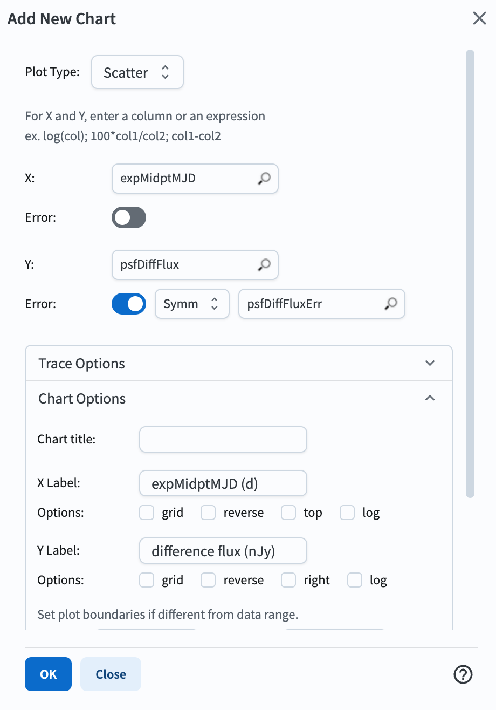
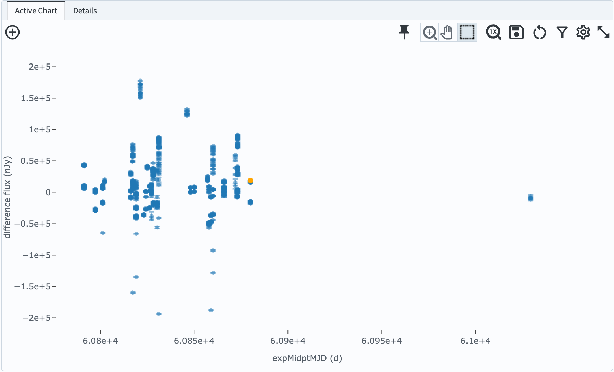
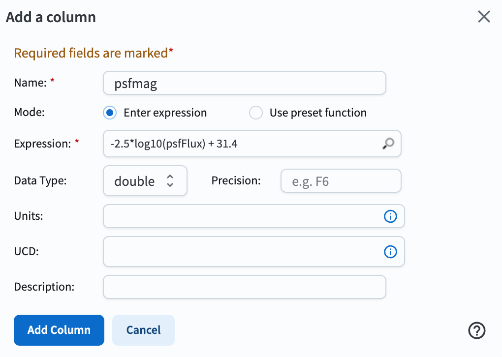
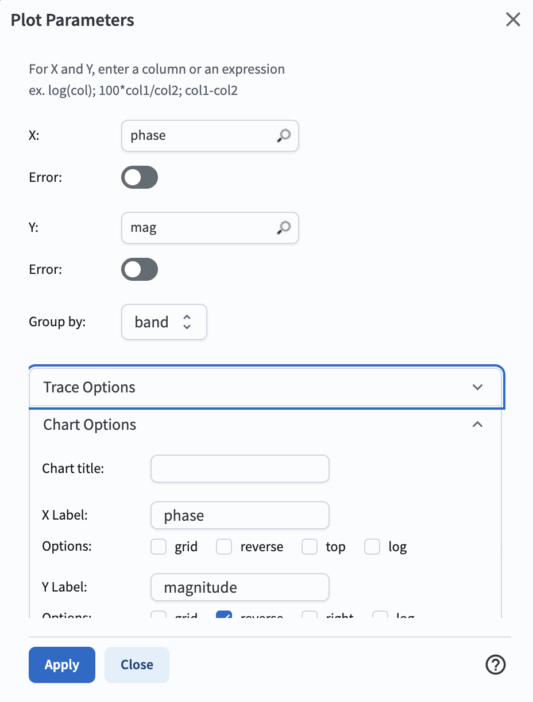

.. _portal-305-1:

#################################
305.1. Variable star light curves
#################################

For the Portal Aspect of the Rubin Science Platform at data.lsst.cloud.

**Data Release:** DP2

**Last verified to run:** 2026-10-20

**Learning objective:** Extract and plot a light curve of a known variable star.

**LSST data products:** ``DiaObject``, ``ForcedSourceOnDiaObject``

**Credit:** Originally developed by the Rubin Community Science team.
Please consider acknowledging them if this tutorial is used for the preparation of journal articles, software releases, or other tutorials.
DOI: `10.11578/rubin/dc.20250909.20 <https://doi.org/10.11578/rubin/dc.20250909.20>`_

**Get Support:** Everyone is encouraged to ask questions or raise issues in the `Support Category <https://www.rubin.community/c/support/6>`_ of the Rubin Community Forum.
Rubin staff will respond to all questions posted there.

----

**1. Execute an ADQL query for a light curve.**
Log in to the Portal Aspect, select the "DP1 & DP2 Catalogs" tab and click on "Edit ADQL" at upper right.
Enter the following ADQL statement and click "Search" at lower left.
This query will return all forced photometry measurements for a known variable star from Gaia, at coordinates (RA, Dec) = (226.7244283498404, -40.30405425755786) degrees.

.. code-block:: SQL

  SELECT diaobj.ra, diaobj.dec, diaobj.diaObjectId, fsodo.visit, fsodo.band,
         fsodo.psfDiffFlux, fsodo.psfDiffFluxErr,
         fsodo.psfFlux as psfFlux, fsodo.psfFluxErr,
         fsodo.psfDiffFlux_flag, fsodo.diff_PixelFlags_nodataCenter,
         fsodo.pixelFlags_saturatedCenter, fsodo.invalidPsfFlag,
         fsodo.pixelFlags_bad, fsodo.psfFlux_flag,
         vis.expMidptMJD
  FROM dp2.DiaObject as diaobj
  JOIN dp2.ForcedSourceOnDiaObject as fsodo ON fsodo.diaObjectId = diaobj.diaObjectId
  JOIN dp2.Visit as vis ON vis.visit = fsodo.visit
  WHERE CONTAINS(POINT('ICRS', diaobj.ra, diaobj.dec),
                 CIRCLE('ICRS', 226.7244283498404, -40.30405425755786, 0.5/3600)) = 1

The above query locates the star of interest in the ``DiaObject`` table, matches based on ``diaObjectId`` to the ``ForcedSourceOnDiaObject`` table to get the forced photometry measurements, then matches based on ``visit`` to the ``Visit`` table to get the observation times, ``expMidptMJD``.
The query should return 887 results.

**2. Plot a light curve (flux vs. time).**
In the "Active Chart" panel, click the "+" to add a chart.
Choose a "Scatter" plot, then select ``psfDiffFlux`` vs. ``expMidptMJD`` to plot a light curve of the difference image flux (see Figure 1 for the plot parameters window).
Include the errors on the flux by toggling the "Y Error" button on, then selecting ``psfDiffFluxErr``.
Enter X and Y labels, then click OK to display the plot.
Delete the default chart that plots RA, Dec coordinates.

    Figure 1: The interface to set plot parameters. It is configured to show "difference flux" and its errors on the y-axis, and "expMidptMJD" on the x-axis.

    Figure 2: The lightcurve of the selected star, showing difference flux vs. the midpoint time of each exposure. The points are scattered about zero flux, indicating that the star sometimes is brighter, and sometimes fainter, than it is in the template image.

The light curve should look like Figure 2.
Fluxes can be positive or negative, as expected for a variable star that sometimes is brighter and sometimes fainter than it is in the template.

This light curve shows measurements from all 6 of the *ugrizy* bands.
Use the filter at the top of the "band" column in the table to select only the *r* band.
The table and plot should change to display only 164 points.
Experiment with toggling different bands on and off.

**3. Plot a phased light curve.**
The selected star was identified as an RR Lyrae variable via its light curve from Gaia DR3.
Its ID is `6005347144427786624 <https://gaia.aip.de/serve/references/source_id/6005347144427786624?job_id=9a24e576-30d9-4d93-9c52-7dd39ba85f86>`_ in Gaia.
This star is classified in Gaia DR3's vari_rrlyrae table as an RRab-type variable with a period of 0.5180638410804721 days.

Calculate magnitudes for the science image forced measurements in the table.
To do so, click the "Add a column" icon at the top of the results table, then enter the parameters shown in Figure 3.
The formula -2.5*log10(psfFlux) + 31.4 converts from flux in nJy to AB magnitudes.
Note that this will often not work for difference fluxes, as they can be negative and will cause the logarithm to fail.

    Figure 3: The interface to calculate a new column value derived from existing columns. The formula -2.5*log10(psfFlux) + 31.4 converts from flux in nJy to AB magnitudes.

Select *g*-band measurements, then change the plot to display ``psfmag`` vs. ``expMidptMJD``.
Reverse the y-axis so brighter magnitudes are toward the top of the plot.

To place each measurement into the RR Lyrae star's phase, one must choose a reference measurement to use as the initial time.
Sort the table by ``expMidptMJD`` so that it is in ascending order (i.e., the earliest measurement appears first).
Use this earliest point as the reference time "t0".
Create a new table column "tdiff" that calculates the difference between each measurement and this reference time, ``expMidptMJD-60791.369557566984`` (where t0=60791.369557566984).

To calculate phase, calculate the number of periods that have passed since t0 as tdiff/period.
Then subtract off the number of full periods that passed from that number using the ``floor`` function, such that ``phase = (tdiff/period)-floor(tdiff/period)``, where ``period=0.5180638410804721`` is the known period.

Change the existing plot to show *g* magnitude vs. ``phase``. This phased light curve should look like Figure 4.

    Figure 4: The light curve of the selected star with measurements placed into their correct phase within the star's variability period. Brightnesses are plotted as magnitudes, showing a variability amplitude of +/-0.6 magnitudes.

